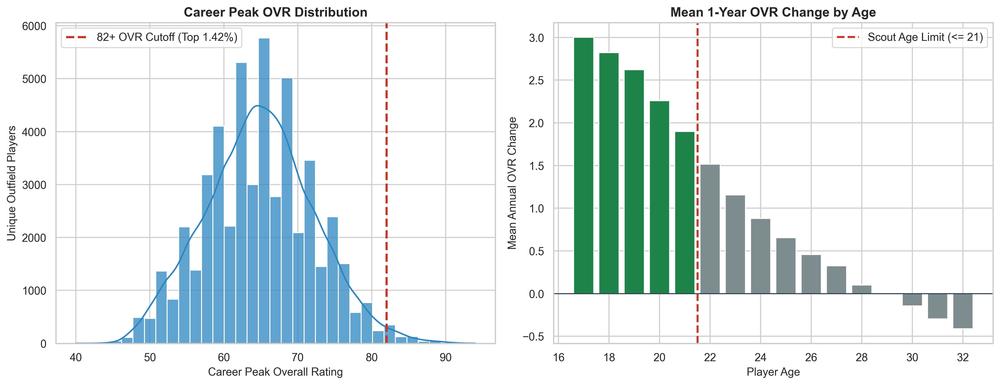
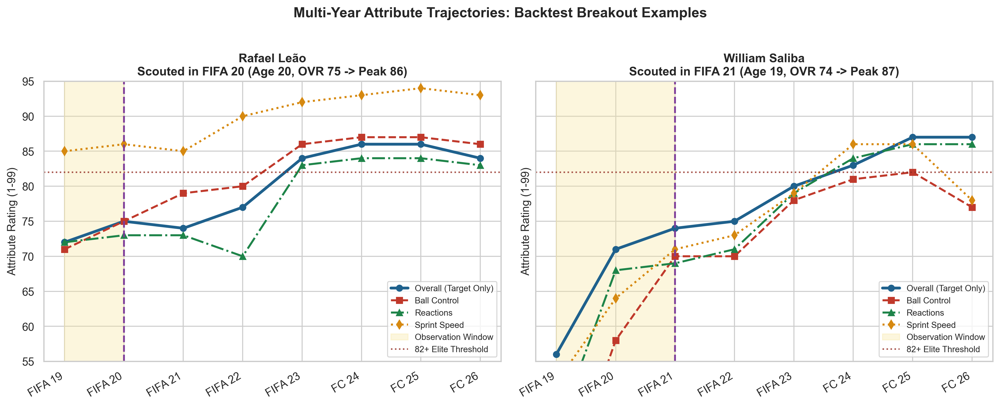
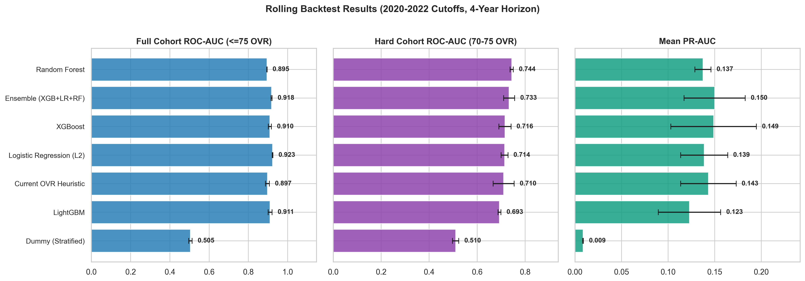
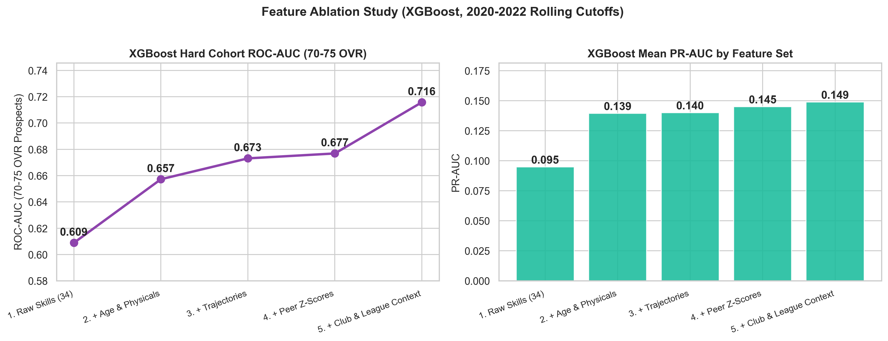
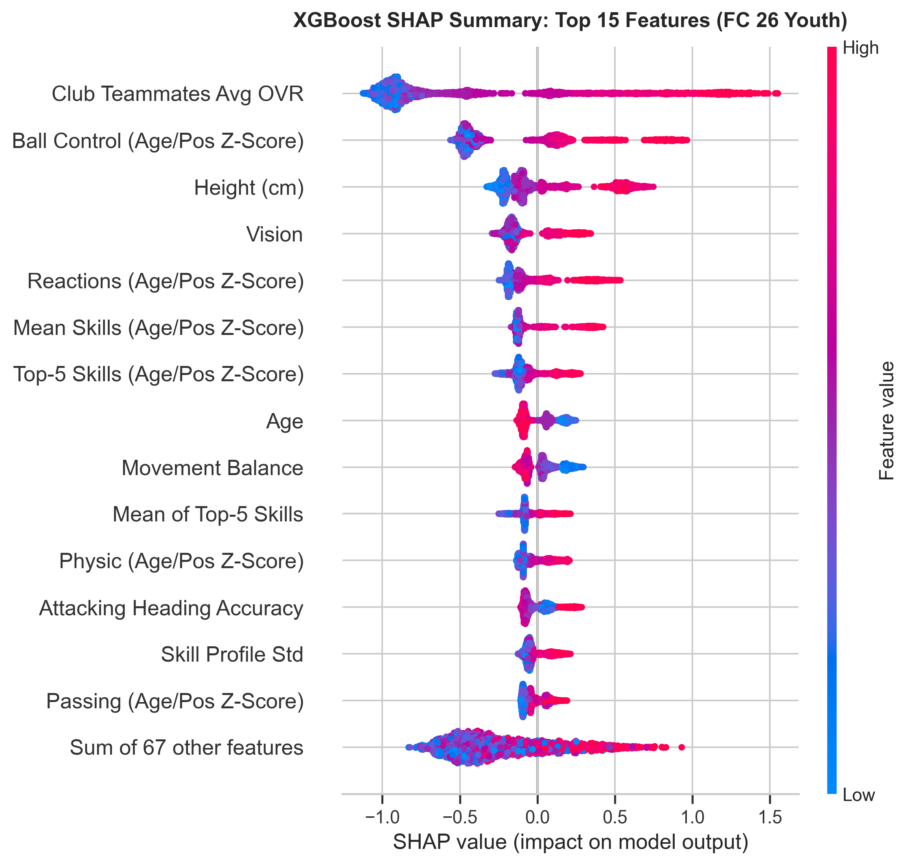
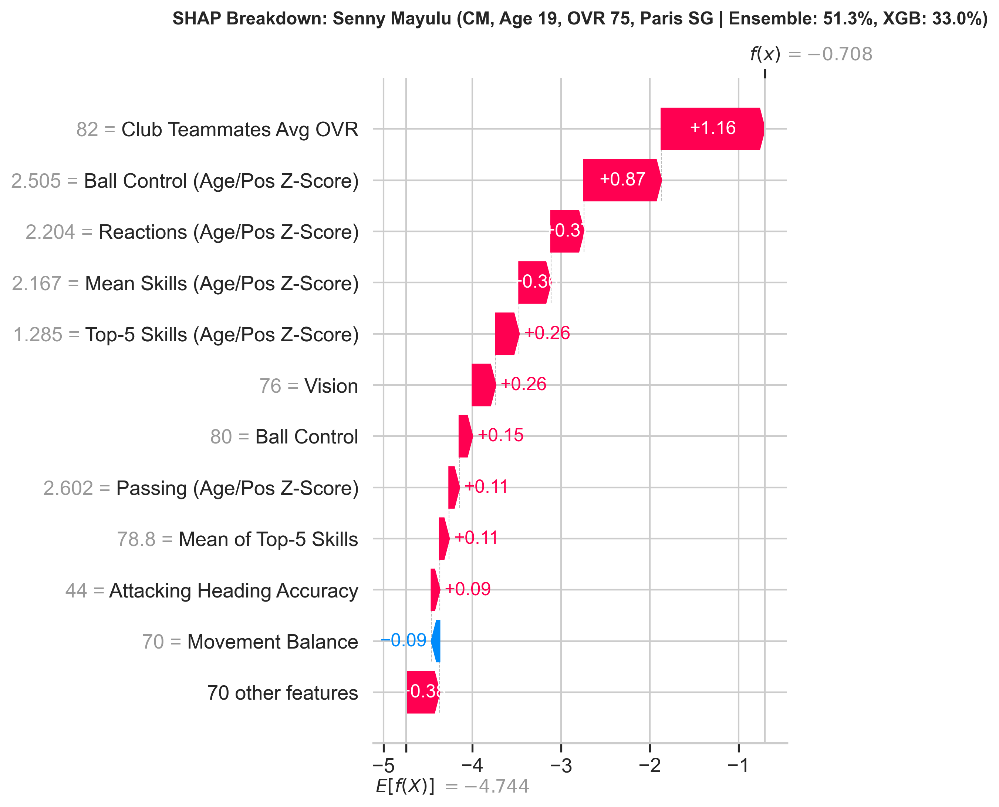

# Football Talent Discovery (FIFA 15 - EA FC 26)

Predicting which under-the-radar young footballers will reach elite level using 12 years of EA Sports FIFA / FC attribute data.

## Problem Definition

Given an outfield player who is **21 or younger** with a current rating of **75 OVR or below**, can we estimate the probability that they reach **82+ OVR** (top 1.42% of career peaks) within the next **4 years**?

To keep the model from simply relying on EA's composite rating, the player's own `overall` column is excluded from all model inputs. Predictions rely only on raw sub-attributes, multi-year growth rates, age/position peer comparisons, and teammate/league context.

## Data & Entity Resolution

Three Kaggle datasets covering FIFA 15 through EA FC 26 (212,410 raw rows) are combined into a single outfield panel:

- **Goalkeepers removed:** 23,657 rows (distinct attribute scale).
- **Clean panel:** 188,753 player-seasons across **51,497 unique outfield players** (0 missing values across the 34 core attributes).
- **Player tracking:** Instead of matching players by name + birth year (which breaks across the FIFA 24 -> FC 25 name format switch and drops linkage to 9.1%), players are linked via the official EA Sports numeric `player_id` (parsed directly from FIFA 15-24 / FC 26 and extracted from player URLs in FC 25). This brings cross-edition linkage to **77.6%** (FC 24 -> FC 25) and **71.0%** (FC 25 -> FC 26).
- **Schema & age alignment:** FC 25 height/weight strings (`182cm / 6'0"`) are parsed to numeric values, FC 26 foot codes (`1/2`) are mapped to `Right/Left`, and player dates of birth are propagated across editions by `player_id` so every edition computes age on the same July 1 season cutoff (achieving 100.0% exact +1 year-over-year age progression across all consecutive appearances).



### Multi-Year Trajectory Examples

Tracking players with `player_id` keeps attribute progressions intact across editions. Below are two breakout players surfaced in the out-of-time backtests:



## Validation Setup (Preventing Leakage & Panel Bias)

Rare-event longitudinal scouting is easy to overfit if train/test splits are handled carelessly. Evaluation uses **rolling-origin backtests across 3 cutoffs (2020, 2021, 2022)** with four rules enforced in code and unit tests:

1. **Fixed 4-year horizon (`H = 4`):** Training samples at cutoff `T` only come from editions `<= T - 4`, so every training label has already matured by year `T`. (2020 is the earliest cutoff where the training window spans at least two editions, FIFA 15-16, allowing longitudinal trajectory features to be learned).
2. **No player overlap:** Any `player_id` in the test cohort at year `T` is dropped from the training set.
3. **Inverse-frequency player weighting:** Because a young player can stay `<= 75 OVR` across multiple training editions (repeated measures), training rows are weighted by `1 / n_appearances` so every unique player contributes equal weight.
4. **No target proxy:** Player `overall` is excluded from all 81 features. Club and league average ratings use leave-one-out averages (excluding the player's own rating) within the same edition.

## Rolling Backtest Results (2020-2022)

Only **0.8% - 0.9%** of youth hidden gems reach 82+ OVR within 4 years. In addition to full-cohort metrics (`<= 75 OVR`), we evaluate **Hard Cohort ROC-AUC (`70-75 OVR`)**: separating the ~290 serious contenders per year who are already close to breaking through, where sorting by current OVR alone drops to `0.710` ROC-AUC. We also report **Brier Skill Score (BSS)** relative to a constant base-rate predictor, and compare against a **Current OVR Heuristic** baseline (ranking players by their actual `overall` rating, with younger age as tie-breaker):

| Model | Full ROC-AUC (<=75) | Hard ROC-AUC (70-75) | Mean PR-AUC | Brier Skill Score | Mean P@15 | Mean Lift@15 |
| :--- | :---: | :---: | :---: | :---: | :---: | :---: |
| **Ensemble (XGB+LR+RF)** | 0.918 | 0.733 | **0.150** | **+5.5%** | 24.4% | 29.1x |
| **Random Forest** | 0.895 | **0.744** | 0.137 | +5.3% | 22.2% | 26.6x |
| **XGBoost** | 0.910 | 0.716 | 0.149 | +4.5% | 22.2% | 25.7x |
| **Logistic Regression (L2)** | **0.923** | 0.714 | 0.139 | +1.8% | 24.4% | 29.5x |
| Current OVR Heuristic | 0.897 | 0.710 | 0.143 | - | **31.1%** | **36.9x** |
| **LightGBM** | 0.911 | 0.693 | 0.123 | +2.9% | 22.2% | 25.7x |
| Dummy (Stratified) | 0.505 | 0.510 | 0.009 | -117.5% | 4.4% | 5.5x |

On the full `<= 75 OVR` pool, much of the ~0.90+ ROC-AUC comes from separating 55 OVR players from 74 OVR players. Inside the **70-75 OVR Hard Cohort**, **Random Forest (`0.744` AUC)**, the **Ensemble (`0.733` AUC, `0.150` PR-AUC)**, and **XGBoost (`0.716` AUC, `0.149` PR-AUC)** all outperform sorting by current `overall` (`0.710` AUC) despite never seeing `overall` as an input.



### Selected Backtest Hits (Top-15, Out-of-Time)

| Cutoff | Player | Pos | Age | Scout OVR | Peak OVR (Next 4y) | Club at Scout Year |
| :---: | :--- | :---: | :---: | :---: | :---: | :--- |
| 2020 | Alphonso Davies | MID | 18 | 72 | 84 | FC Bayern Munchen |
| 2020 | Rafael Leao | ATT | 20 | 75 | 86 | AC Milan |
| 2020 | Dominik Szoboszlai | MID | 18 | 74 | 82 | RB Salzburg |
| 2021 | William Saliba | DEF | 19 | 74 | 87 | Arsenal |
| 2021 | Aurelien Tchouameni | MID | 20 | 71 | 85 | AS Monaco |
| 2021 | Pedri | MID | 17 | 72 | 86 | FC Barcelona |
| 2021 | Mohammed Kudus | MID | 19 | 75 | 82 | Ajax |
| 2022 | Jamal Musiala | MID | 18 | 75 | 88 | FC Bayern Munchen |
| 2022 | Michael Olise | MID | 19 | 73 | 86 | Crystal Palace |
| 2022 | Josko Gvardiol | DEF | 19 | 75 | 84 | RB Leipzig |
| 2022 | Jurrien Timber | DEF | 20 | 75 | 82 | Ajax |
| 2022 | Charles De Ketelaere | ATT | 20 | 75 | 82 | Club Brugge |

## Feature Ablation (XGBoost)

| Feature Stage | Features | Full ROC-AUC | Hard ROC-AUC (70-75) | Mean PR-AUC | Mean Lift@15 |
| :--- | :---: | :---: | :---: | :---: | :---: |
| 1. Raw Skills | 34 | 0.867 | 0.609 | 0.095 | 13.1x |
| 2. + Age & Physicals | 46 | 0.894 | 0.657 | 0.139 | 34.3x |
| 3. + Trajectories | 70 | 0.893 | 0.673 | 0.140 | **36.9x** |
| 4. + Peer Z-Scores | 79 | 0.889 | 0.677 | 0.145 | 36.8x |
| 5. + Club & League Context | 81 | **0.910** | **0.716** | **0.149** | 25.7x |

Every feature group improves both **Hard Cohort ROC-AUC** (`0.609 -> 0.657 -> 0.673 -> 0.677 -> 0.716`) and **PR-AUC** (`0.095 -> 0.139 -> 0.140 -> 0.145 -> 0.149`) monotonically.



## SHAP Explanations

Global SHAP values (computed via XGBoost native `pred_contribs`) show that the main drivers are squad environment (`Club Teammates Avg OVR`), age- and position-adjusted technical/mental outliers (`Ball Control`, `Reactions`, `Vision`), and youth (`Age`):



For an individual example, top-ranked prospect **Senny Mayulu** (19, CM, OVR 75, Paris SG | Ensemble: 51.3%, XGB: 33.0%) is pushed upward by squad strength, peer-normalized ball control, and reactions:



## EA FC 26 Top Prospects (Age <= 21, OVR <= 75)

Trained on all matured `FIFA 15-22` cohorts (`H = 4`) and evaluated on 3,208 FC 26 youth prospects:

| Pos | Rank | Player | Age | Current OVR | Club | XGB Prob | Ensemble Prob |
| :---: | :---: | :--- | :---: | :---: | :--- | :---: | :---: |
| ATT | 1 | Charalampos Kostoulas | 18 | 72 | Brighton | 29.3% | 34.3% |
| ATT | 2 | Marc Guiu | 19 | 71 | Chelsea | 33.4% | 32.5% |
| ATT | 3 | Wilson Odobert | 20 | 75 | Spurs | 32.1% | 29.0% |
| ATT | 4 | Ruben van Bommel | 20 | 74 | PSV | 34.0% | 28.4% |
| ATT | 5 | Eli Junior Kroupi | 19 | 74 | AFC Bournemouth | 26.8% | 24.4% |
| MID | 1 | Senny Mayulu | 19 | 75 | Paris SG | 33.0% | 51.3% |
| MID | 2 | Marc Bernal | 18 | 73 | FC Barcelona | 25.7% | 39.5% |
| MID | 3 | Tyler Dibling | 19 | 74 | Everton | 39.1% | 38.7% |
| MID | 4 | Jobe Bellingham | 19 | 74 | Borussia Dortmund | 29.0% | 35.9% |
| MID | 5 | Ayyoub Bouaddi | 17 | 75 | LOSC Lille | 31.8% | 33.7% |
| DEF | 1 | El Chadaille Bitshiabu | 20 | 75 | RB Leipzig | 22.3% | 36.4% |
| DEF | 2 | Pietro Comuzzo | 20 | 74 | Fiorentina | 25.4% | 31.7% |
| DEF | 3 | Jeremy Jacquet | 19 | 75 | Stade Rennais FC | 29.4% | 29.0% |
| DEF | 4 | Martim Fernandes | 19 | 75 | FC Porto | 31.2% | 28.9% |
| DEF | 5 | Patrick Dorgu | 20 | 74 | Man Utd | 24.0% | 28.9% |

The top-10 shortlist per position (with top-3 SHAP drivers) is tracked in [`outputs/metrics/fc26_top10_by_position.csv`](outputs/metrics/fc26_top10_by_position.csv); running `python run_pipeline.py` also exports the full 3,208-player table to `outputs/metrics/fc26_predictions_all.csv`.

## Repository Layout

```text
football-talent-discovery/
├── config.yaml                  # Cohort rules, horizon & feature lists
├── run_pipeline.py              # CLI entrypoint
├── requirements.txt
├── pyproject.toml
├── src/
│   ├── config.py                # Path & YAML loader
│   ├── preprocess.py            # Schema alignment & EA player_id linkage
│   ├── features.py              # Causal features, weights, labels & splits
│   ├── models.py                # Weighted pipelines & native XGBoost SHAP
│   ├── evaluate.py              # Rolling backtest, hard-cohort & ablation
│   ├── predict.py               # Final fit (FIFA 15-22) & FC 26 scoring
│   └── visualize.py             # EDA, benchmark, ablation & SHAP plots
├── tests/
│   ├── test_preprocessing.py
│   └── test_leakage.py
└── outputs/
    ├── figures/
    └── metrics/
```

## How to Run

1. Install dependencies:
```bash
python -m venv .venv
# Windows: .venv\Scripts\activate  |  Linux/macOS: source .venv/bin/activate
pip install -r requirements.txt
```

2. Download the three raw CSVs from Kaggle into `data/raw/`:
   - `FC_15_24_male_players.csv`: [EA Sports FC 24 Complete Player Dataset (Stefano Leone)](https://www.kaggle.com/datasets/stefanoleone992/ea-sports-fc-24-complete-player-dataset)
   - `FC_25_male_players.csv`: [EA Sports FC 25 Database Ratings and Stats (Nyagami)](https://www.kaggle.com/datasets/nyagami/ea-sports-fc-25-database-ratings-and-stats)
   - `ea_fc26_players.csv`: [EA Sports FC 26 Player Ratings (JustDhia)](https://www.kaggle.com/datasets/justdhia/ea-sports-fc-26-player-ratings)

3. Run the pipeline and tests:
```bash
python run_pipeline.py
pytest -v
```

## Notes & Limitations

- **Attribute proxy vs. match logs:** EA ratings are scout-curated attributes rather than raw match-event data (xG, progressive passes, minutes played, injury logs). The same pipeline structure can be adapted to club-internal scouting scores or Football Manager databases.
- **Database attrition (right-censoring):** Roughly 21% - 24% of youth players in a given test edition do not appear in any subsequent edition over the 4-year window (typically due to dropping to unlicensed lower divisions or retiring) and are coded as `target_elite = 0`. While players leaving licensed top divisions virtually never reach 82+ OVR within 4 years, this represents an informative dropout assumption.
- **Big-club bias:** `club_teammate_avg_ovr` is a strong predictor because top academies sign top talent early, though it can favor reserves at big clubs over lower-league gems. Dropping club/league features (Stage 4 in the ablation table) gives a club-agnostic ranking focused purely on individual skills and trajectories.
- **Unobserved factors:** Injuries, playing time, and transfers cannot be observed from attribute ratings alone.

## Background

This project grew out of my undergraduate thesis. The original version used a single 2020 backtest; while revisiting it I found that training labels were using post-2020 data and players overlapped between train and test sets. This repo is the corrected version with exact player-ID linkage and rolling out-of-time validation.

## License

MIT License - Kerem Tekin
